

  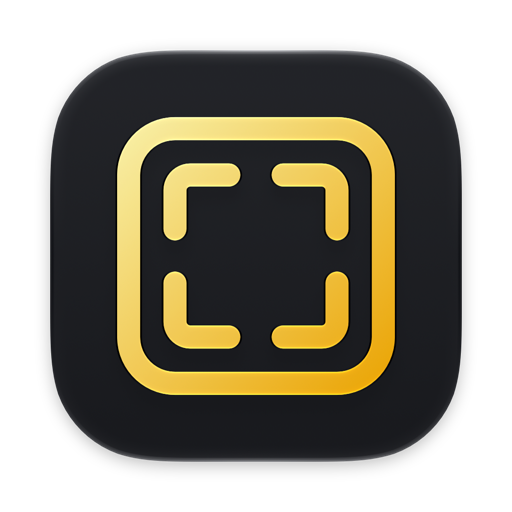

<h1 align="center">mmWebShot</h1>

  Screenshots von Webseiten – in exakt der Grösse, die du brauchst, ohne Cookie-Banner. 
  <a href="../../releases/latest"><b>Download</b></a> · <a href="#english">English</a>

<picture>
  <source media="(prefers-color-scheme: dark)" srcset="images/de/hero-dark.png">
  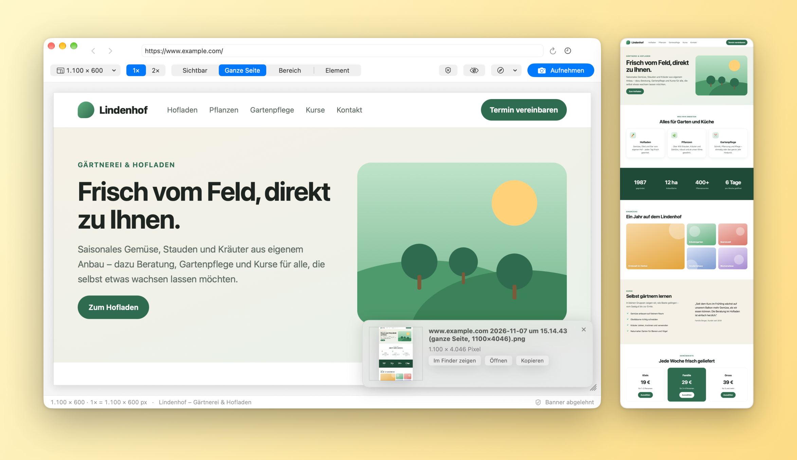
</picture>

## Funktionen

- **Exakter Anzeigebereich:** Die Seite erscheint genau so gross, wie du sie aufnehmen willst – z. B. 1.280 × 600. Vorlagen für Desktop, Laptop, Tablet und Smartphone, eigene Grösse oder einfach an der Kante der Seite ziehen. Aufnahme in 1× (genau diese Pixel) oder 2× (Retina).
- **Vier Aufnahmearten:** sichtbarer Bereich, **ganze Seite** von oben bis unten, ein mit der Maus aufgezogener **Bereich** oder ein angeklicktes **Element** (z. B. ein Abschnitt der Seite).
- **Ganze Seiten, die stimmen:** Die Seite wird abschnittsweise aufgenommen und nahtlos zusammengesetzt. Mitlaufende Kopfzeilen erscheinen nur einmal oben, nachgeladene Bilder sind da, Einblend-Effekte (AOS, WOW, GSAP, Elementor, Webflow …) stehen fertig, Animationen sind angehalten. „100vh“-Abschnitte werden nicht aufgebläht.
- **Cookie-Banner verschwinden:** Die verbreiteten Consent-Tools (Usercentrics, Cookiebot, OneTrust, Borlabs, consentmanager, Didomi, Sourcepoint, Complianz, CookieYes und viele mehr) werden direkt beantwortet – ab Werk mit „Ablehnen“, wahlweise „Akzeptieren“ oder nur ausblenden. Chat-Knöpfe verschwinden gleich mit.
- **Selbst eingreifen:** Die Vorschau ist ein echter Browser – klicken, scrollen, anmelden. Mit „Ausblenden“ klickst du störende Elemente einfach weg.
- **Aus Safari aufnehmen:** Seiten, die du in Safari vorbereitet hast, nimmt mmWebShot direkt von dort auf – das Safari-Fenster wird dafür auf den Anzeigebereich eingestellt.
- **PNG, JPEG oder WebP** mit wählbarer Qualität, Ablage in einem Ordner deiner Wahl und/oder in der Zwischenablage.
- **Signiert und von Apple beglaubigt**, **automatische Updates** nach Bestätigung, **Deutsch, Englisch, Französisch, Italienisch und Spanisch**, Liquid Glass ab macOS 26.

<picture>
  <source media="(prefers-color-scheme: dark)" srcset="images/de/browser-dark.png">
  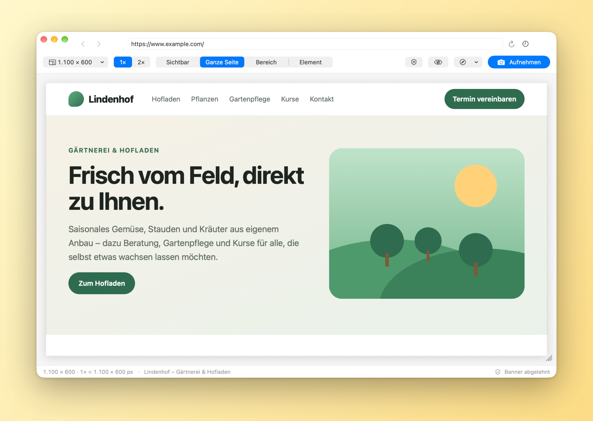
</picture>

## Einstellungen

  <picture>
    <source media="(prefers-color-scheme: dark)" srcset="images/de/settings-capture-dark.png">
    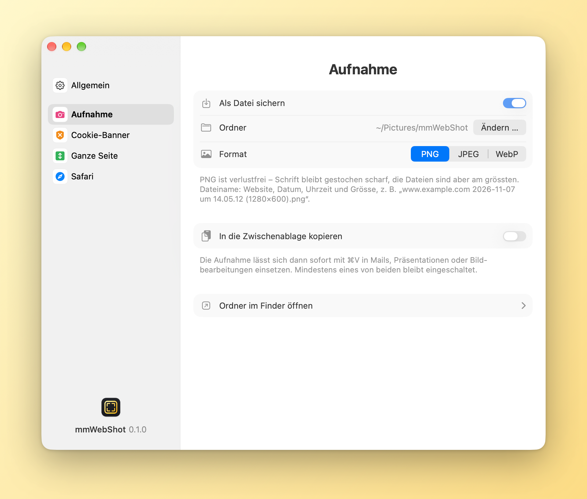
  </picture>
  <picture>
    <source media="(prefers-color-scheme: dark)" srcset="images/de/settings-consent-dark.png">
    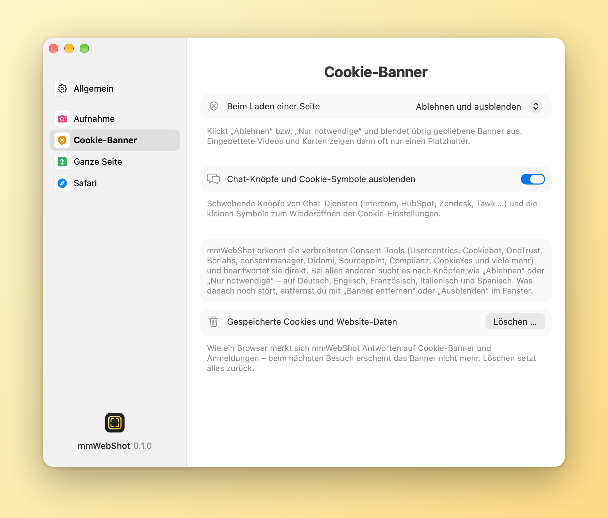
  </picture>

  <picture>
    <source media="(prefers-color-scheme: dark)" srcset="images/de/settings-fullpage-dark.png">
    
  </picture>
  <picture>
    <source media="(prefers-color-scheme: dark)" srcset="images/de/settings-safari-dark.png">
    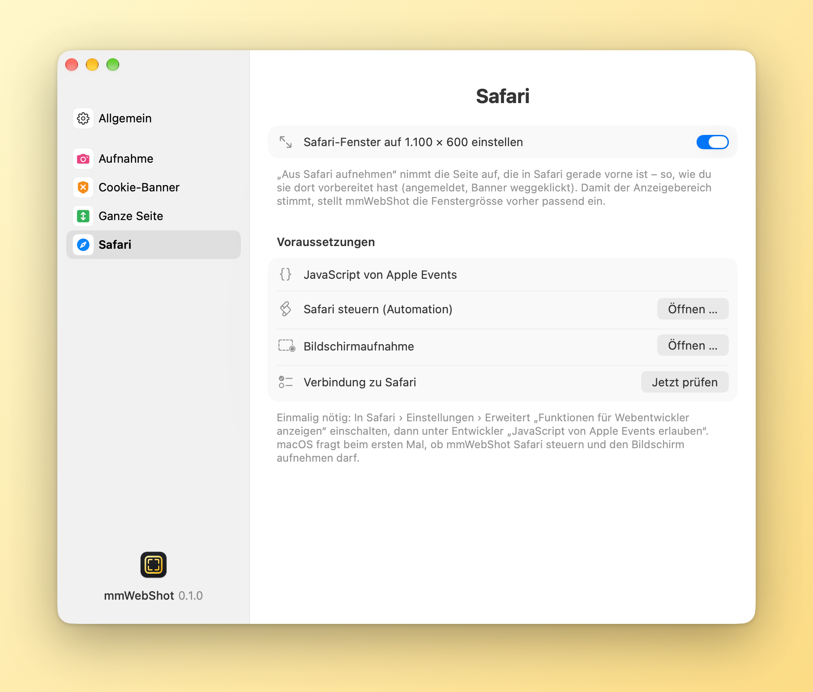
  </picture>

  <picture>
    <source media="(prefers-color-scheme: dark)" srcset="images/de/settings-general-dark.png">
    
  </picture>
  <picture>
    <source media="(prefers-color-scheme: dark)" srcset="images/de/about-dark.png">
    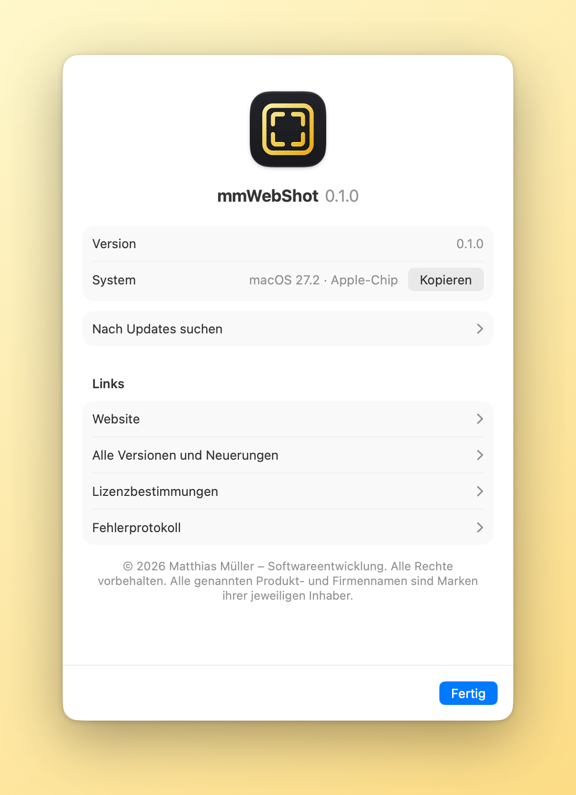
  </picture>

## Download und Installation

1. Unter [Releases](../../releases/latest) die Datei `mmWebShot-<Version>.dmg` herunterladen.
2. DMG öffnen und mmWebShot in den Ordner „Programme“ ziehen.
3. mmWebShot per Doppelklick öffnen – die App ist mit einem Apple-Entwicklerzertifikat signiert und von Apple beglaubigt (notarisiert), es erscheint keine Sicherheitsabfrage.

Danach aktualisiert sich mmWebShot selbst: Die App sucht täglich nach neuen Versionen und installiert sie nach Bestätigung (mmWebShot › „Nach Updates suchen …“).

## Bedienung

1. Adresse eingeben und mit ↩ laden.
2. Grösse wählen (Menü links oben oder an Kante/Ecke der Seite ziehen), 1× oder 2×.
3. Aufnahmeart wählen und **Aufnehmen** (⌘S). Das Bild liegt in Bilder › mmWebShot; die Karte unten rechts zeigt es im Finder, öffnet oder kopiert es.

Kurzbefehle: ⌘⇧1–4 nimmt direkt sichtbar, ganze Seite, Bereich oder Element auf · ⌘K Cookie-Banner entfernen · ⌘E Elemente ausblenden · ⌥⌘S aus Safari aufnehmen · ⌘L Adresse.

**Aus Safari aufnehmen** braucht einmalig: Safari › Einstellungen › Erweitert „Funktionen für Webentwickler anzeigen“, dann unter Entwickler „JavaScript von Apple Events erlauben“; beim ersten Mal fragt macOS, ob mmWebShot Safari steuern und den Bildschirm aufnehmen darf.

## Grenzen

- Seiten, die Abschnitte beim Scrollen festpinnen und überblenden (Scroll-Inszenierungen), haben keinen „ganzen“ Zustand – dort lässt sich die ganze Seite nur annähern.
- Endlos nachladende Seiten werden bei der eingestellten Höchsthöhe abgeschnitten (ab Werk 20.000 Pixel).
- Videos erscheinen als Standbild.

## Voraussetzungen

- macOS 14 (Sonoma) oder neuer, Mac mit Apple-Chip oder Intel

---

## English

<picture>
  <source media="(prefers-color-scheme: dark)" srcset="images/en/hero-dark.png">
  
</picture>

mmWebShot takes screenshots of web pages – in exactly the size you need, without cookie banners.

- **Exact viewport:** the page appears exactly as large as you want to capture it – e.g. 1,280 × 600. Presets for desktop, laptop, tablet and smartphone, a custom size, or simply drag the edge of the page. Capture at 1× (exactly these pixels) or 2× (Retina).
- **Four ways to capture:** the visible area, the **full page** from top to bottom, an **area** dragged with the mouse, or a clicked **element** (such as one section of the page).
- **Full pages that are right:** the page is captured in sections and stitched together seamlessly. Sticky headers appear only once at the top, lazy-loaded images are there, reveal effects (AOS, WOW, GSAP, Elementor, Webflow …) are finished, animations are stopped. “100vh” sections don’t get stretched.
- **Cookie banners disappear:** the common consent tools (Usercentrics, Cookiebot, OneTrust, Borlabs, consentmanager, Didomi, Sourcepoint, Complianz, CookieYes and many more) are answered directly – “Decline” by default, or “Accept”, or just hidden. Chat buttons go too.
- **Step in yourself:** the preview is a real browser – click, scroll, sign in. “Hide” lets you click away anything that’s in the way.
- **Capture from Safari:** pages you prepared in Safari are captured right from there – the Safari window is set to the viewport size first.
- **PNG, JPEG or WebP** with adjustable quality, saved to a folder of your choice and/or to the clipboard.
- **Signed and notarized by Apple**, **automatic updates** once you confirm, **English, German, French, Italian and Spanish**, Liquid Glass on macOS 26 and later.

<picture>
  <source media="(prefers-color-scheme: dark)" srcset="images/en/browser-dark.png">
  
</picture>

  <picture>
    <source media="(prefers-color-scheme: dark)" srcset="images/en/settings-capture-dark.png">
    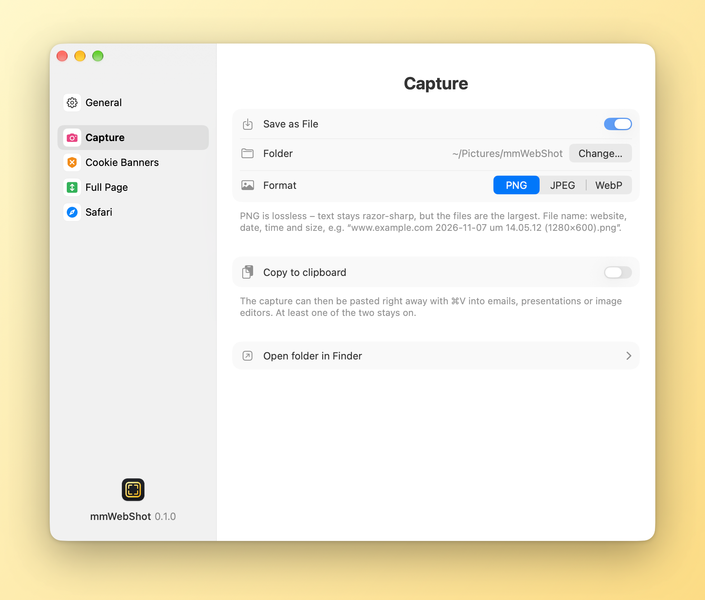
  </picture>
  <picture>
    <source media="(prefers-color-scheme: dark)" srcset="images/en/settings-consent-dark.png">
    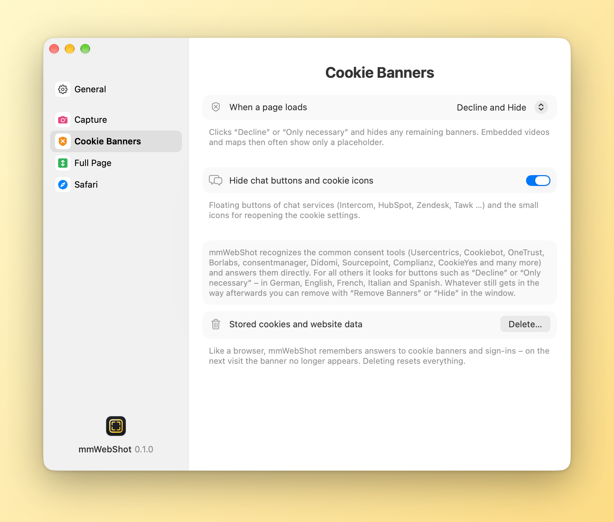
  </picture>

  <picture>
    <source media="(prefers-color-scheme: dark)" srcset="images/en/settings-fullpage-dark.png">
    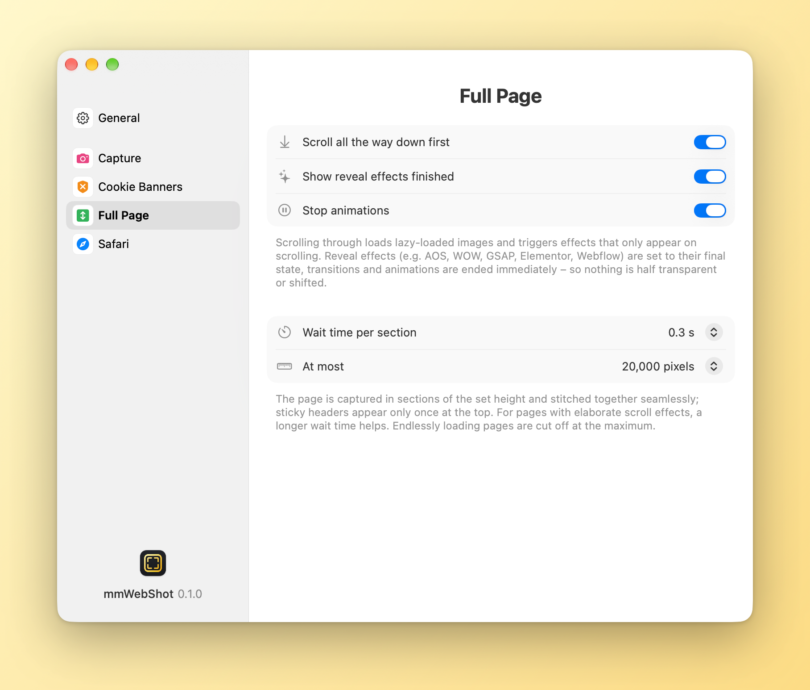
  </picture>
  <picture>
    <source media="(prefers-color-scheme: dark)" srcset="images/en/settings-safari-dark.png">
    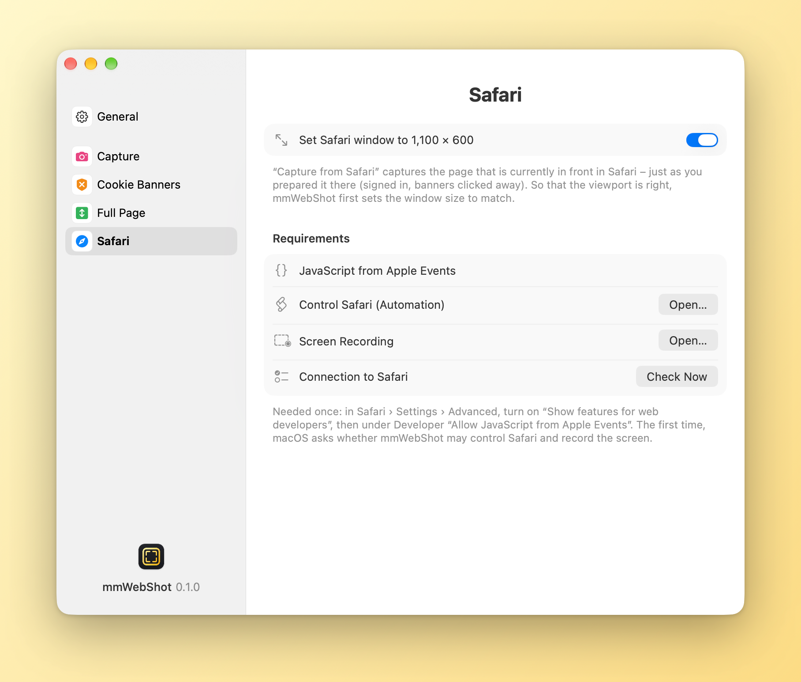
  </picture>

  <picture>
    <source media="(prefers-color-scheme: dark)" srcset="images/en/settings-general-dark.png">
    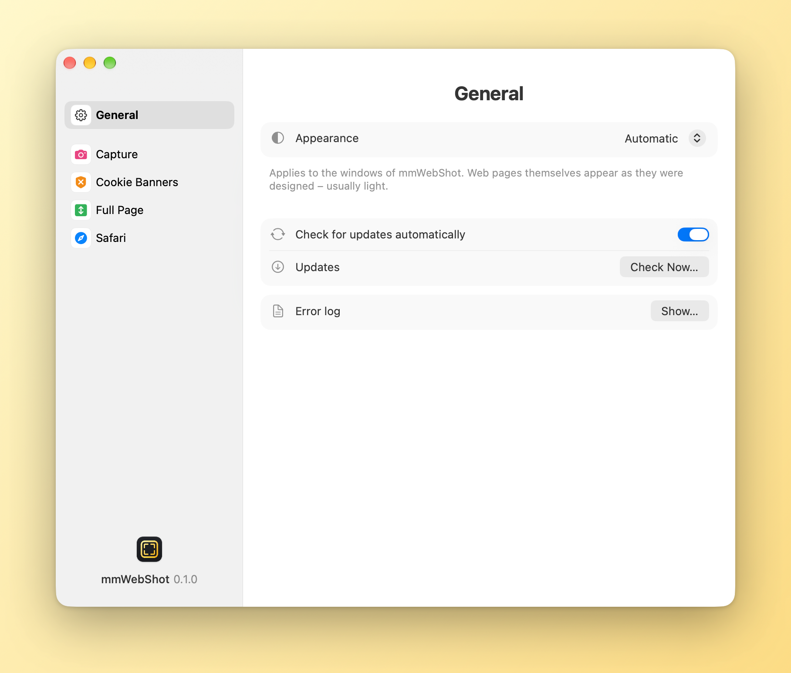
  </picture>
  <picture>
    <source media="(prefers-color-scheme: dark)" srcset="images/en/about-dark.png">
    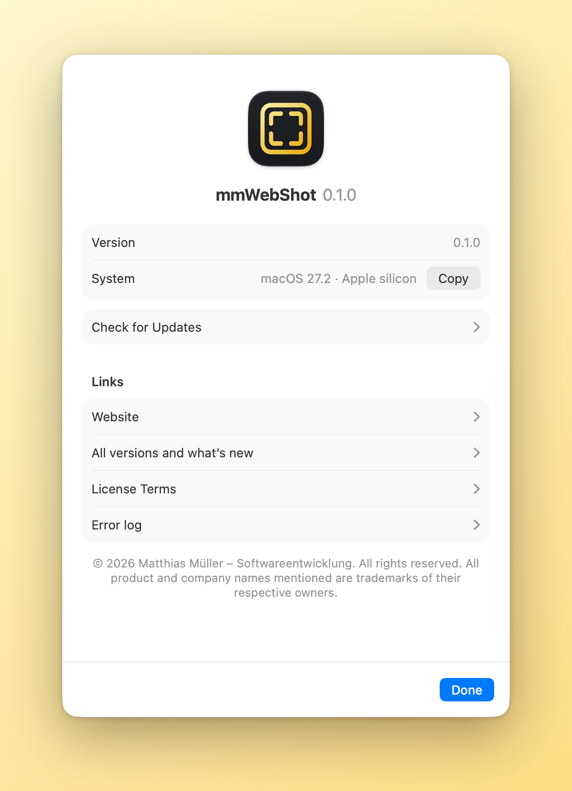
  </picture>

### Download and installation

1. Download `mmWebShot-<version>.dmg` from [Releases](../../releases/latest).
2. Open the disk image and drag mmWebShot to the Applications folder.
3. Double-click mmWebShot – the app is signed with an Apple developer certificate and notarized by Apple, so macOS opens it without any warning.

After that mmWebShot updates itself: it checks for new versions daily and installs them once you confirm (mmWebShot › “Check for Updates…”).

### How to use it

1. Enter an address and press ↩.
2. Choose the size (menu at the top left, or drag the edge/corner of the page), 1× or 2×.
3. Choose how to capture and click **Capture** (⌘S). The picture goes to Pictures › mmWebShot; the card at the bottom right shows it in Finder, opens or copies it.

Shortcuts: ⌘⇧1–4 captures visible, full page, area or element right away · ⌘K remove cookie banners · ⌘E hide elements · ⌥⌘S capture from Safari · ⌘L address.

**Capture from Safari** needs, once: Safari › Settings › Advanced “Show features for web developers”, then under Developer “Allow JavaScript from Apple Events”; the first time, macOS asks whether mmWebShot may control Safari and record the screen.

### Limits

- Pages that pin and cross-fade sections while scrolling (scroll storytelling) have no “whole” state – the full page can only be approximated there.
- Endlessly loading pages are cut off at the maximum height you set (20,000 pixels by default).
- Videos appear as a still image.

### Requirements

- macOS 14 (Sonoma) or later, Mac with Apple silicon or Intel

---

© 2026 Matthias Müller – Softwareentwicklung · Alle Rechte vorbehalten / All rights reserved · [Lizenzbestimmungen / License terms](LICENSE.md) · [www.mm-softwareentwicklung.de](https://www.mm-softwareentwicklung.de)

Alle genannten Produkt- und Firmennamen sind Marken ihrer jeweiligen Inhaber. 
All product and company names mentioned are trademarks of their respective owners.
